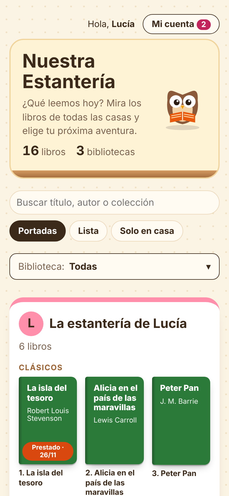
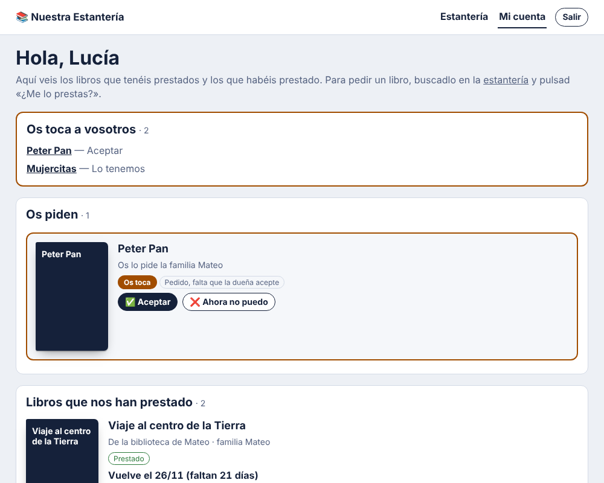
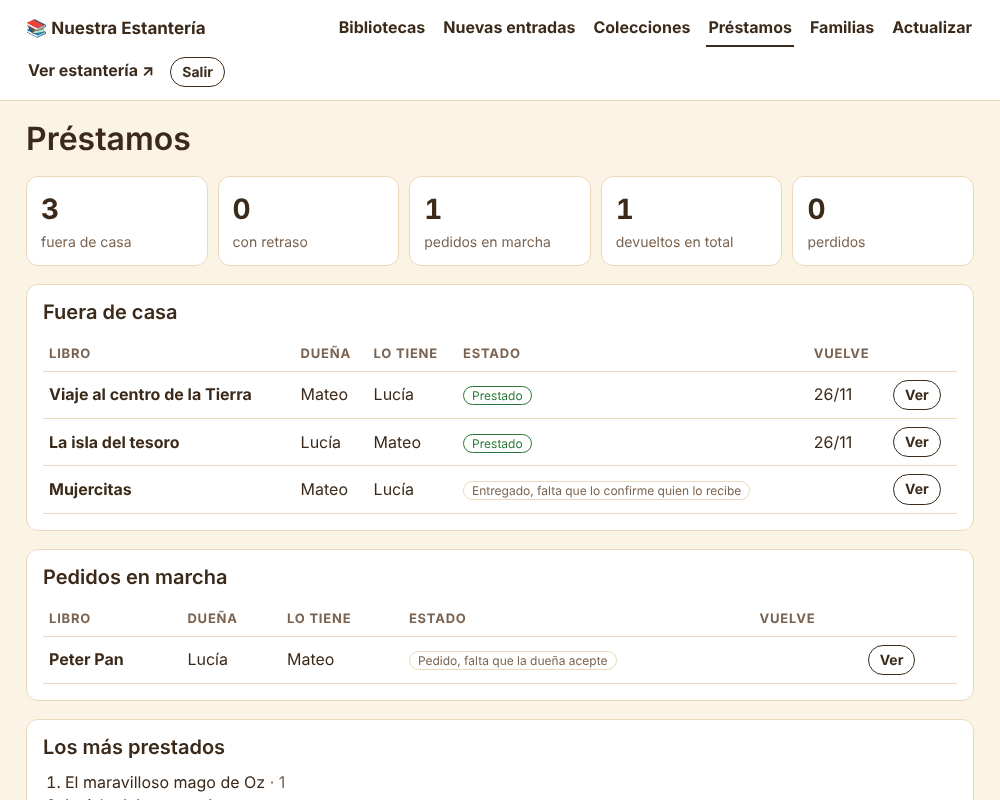

# 📚 Nuestra Estantería

Una biblioteca compartida para un grupo de familias: cada familia enseña los libros que tiene en casa, los niños y niñas curiosean qué hay en las demás estanterías, y las familias se prestan libros entre ellas con avisos por Telegram.

Pensada para instalarse en casa, en un contenedor LXC de **Proxmox VE**, con un solo comando.

<p align="center">
  
  
</p>

## Qué hace

**Para las familias**

- **Estantería pública** con las portadas de todos los libros, agrupados por biblioteca y colección. Buscador, vista de portadas o de lista y filtro «Solo en casa». Funciona bien en el móvil.
- **Préstamos entre familias** con doble confirmación: «¿Me lo prestas?» → la dueña acepta → «Ya se lo he dado» → «Lo tenemos» → … → «Ya lo tengo de vuelta». Nadie puede dar un préstamo por terminado sin que la otra familia lo confirme.
- **Mi cuenta**: lo que os toca confirmar, los libros que os han prestado, los que habéis prestado, lo que habéis pedido y el historial.
- **Avisos por Telegram** con botones para confirmar sin abrir la web, y recordatorios antes de la fecha de devolución.
- «**Avísame cuando vuelva**», **prórrogas** de 14 días, bibliotecas «**solo para mirar**» y libros **perdidos**.
- En la parte pública solo se ve «Prestado · vuelve hacia el 26/11», **nunca quién lo tiene**.

**Para quien la administra**

- **Añadir libros escribiendo solo el título** (o el ISBN). Busca a la vez en Todostuslibros, Elkar, Google Books y Open Library y rellena autor, páginas, colección, número y portada.
- **Leer una foto de los lomos** con IA (Gemini, opcional) para dar de alta una estantería entera de golpe.
- **Resúmenes para niños** escritos por la IA a partir de la sinopsis de la editorial, marcados como «sin revisar» hasta que los revisas.
- **Completar datos que faltan** de los libros ya guardados, con coincidencia estricta para no mezclar libros.
- **Familias** por invitación (un enlace de un solo uso), **préstamos** con estadísticas y resolución de desacuerdos.
- **Copias de seguridad**: diaria en el contenedor, antes de cada actualización, semanal por Telegram y descarga en .zip desde el panel. Se pueden **importar** desde el panel.
- **Actualizaciones desde la web**: avisa cuando hay versión nueva en GitHub y se instala con un botón.

<p align="center">
  
  
</p>

## Instalación en Proxmox (recomendada)

En la **consola del host de Proxmox** (Datacenter → tu nodo → Shell), como root:

```bash
bash -c "$(curl -fsSL https://raw.githubusercontent.com/hombrelobo2/biblioteca/main/proxmox/estanteria.sh)"
```

El script te pregunta lo justo (pulsa Enter para aceptar cada valor por defecto) y hace el resto:

1. Descarga la plantilla **Debian 13** si no la tienes.
2. Crea un contenedor LXC sin privilegios (1 núcleo, 512 MB de RAM, 4 GB de disco, arranque automático).
3. Le pone la zona horaria del host.
4. Instala nginx, Python, la aplicación, el bot de Telegram, los recordatorios y las copias de seguridad.
5. Te muestra la dirección y las contraseñas.

Hecho para Proxmox VE 9. En Proxmox VE 8 debería funcionar igual si puede descargar la plantilla de Debian 13.

<details>
<summary>Instalación sin preguntas (para automatizar)</summary>

```bash
SIN_PREGUNTAS=1 CT_ID=150 CT_IP=192.168.1.50/24 CT_GW=192.168.1.1 \
ESTANTERIA_ADMIN_PASS='una-contraseña-larga' ESTANTERIA_URL=https://estanteria.midominio.com \
bash -c "$(curl -fsSL https://raw.githubusercontent.com/hombrelobo2/biblioteca/main/proxmox/estanteria.sh)"
```

Todas las variables están explicadas al principio de [`proxmox/estanteria.sh`](proxmox/estanteria.sh).
</details>

## Instalación en cualquier Debian 13

En un Debian 13 limpio (contenedor, máquina virtual o un servidor pequeño), como root:

```bash
apt-get update && apt-get install -y curl
curl -fsSL https://github.com/hombrelobo2/biblioteca/archive/refs/heads/main.tar.gz | tar -xz
cd biblioteca-main && bash install.sh
```

El instalador te pide la contraseña de administración. Ocupa el puerto 80 con nginx.

## Después de instalar

1. Entra en `http://IP/admin/` con la contraseña de administración.
2. **Crea las bibliotecas** y añade libros en «Nuevas entradas».
3. **Publícala en internet con HTTPS** a través de tu proxy (Nginx Proxy Manager, Cloudflare Tunnel, Traefik…) apuntando al puerto 80 del contenedor. Deben verse desde fuera `/` y `/cuenta`. Para `/admin` lo recomendable es dejarlo solo para tu red de casa ([cómo](docs/instalacion.md#publicarla-en-internet)).
4. **Activa Telegram** (opcional, pero es lo que hace cómodos los préstamos): [docs/telegram.md](docs/telegram.md).
5. **Invita a las familias** desde /admin → Familias: cada una recibe un enlace para elegir su contraseña.

## Actualizar

**Desde la web:** `/admin` → **Actualizar**. Ahí ves la versión instalada, la última publicada y sus novedades, y la instalas con un botón. Si tienes Telegram vinculado, te avisa cuando sale una versión nueva.

Desde el host de Proxmox (cambia `112` por el número de tu contenedor):

```bash
bash -c "$(curl -fsSL https://raw.githubusercontent.com/hombrelobo2/biblioteca/main/proxmox/estanteria.sh)" -- actualizar 112
```

O dentro del contenedor: `estanteria-actualizar`. Antes de tocar nada se guarda una copia de la base de datos, y se conservan los libros, las portadas, las contraseñas y la configuración.

## Documentación

📖 **[Guía para niños y niñas (PDF)](docs/guia-para-ninos.pdf)**: qué es la estantería y cómo se usa, explicado para los lectores y lectoras de la casa. Se puede imprimir.

| | |
|---|---|
| [Instalación y mantenimiento](docs/instalacion.md) | Qué se instala y dónde, HTTPS, copias de seguridad, restaurar, problemas frecuentes |
| [Configuración](docs/configuracion.md) | Todas las opciones de `/etc/estanteria/estanteria.env` |
| [Añadir libros](docs/libros.md) | Nuevas entradas, foto de los lomos, resúmenes, completar datos, colecciones |
| [Préstamos](docs/prestamos.md) | Familias, cómo va un préstamo, desacuerdos, recordatorios |
| [Telegram](docs/telegram.md) | Crear el bot y vincular a las familias |
| [Desarrollo](docs/desarrollo.md) | Cómo está hecho y cómo probarlo en tu ordenador |

## Privacidad

- La estantería pública muestra los nombres de las bibliotecas (usa solo nombres de pila) y los libros. **No muestra quién tiene cada libro prestado.**
- Las contraseñas se guardan cifradas (hash). Los enlaces de invitación y de Telegram son de un solo uso y en la base de datos solo se guarda su huella.
- Todo se queda en tu contenedor. Solo salen fuera las búsquedas de libros (a las librerías y a Google/Open Library), las fotos y sinopsis que mandas a Gemini si lo activas, y los avisos a Telegram si lo activas.

## Licencia

Nuestra Estantería es **software libre** bajo la licencia [GNU GPL v3](LICENSE): puedes usarla, estudiarla, cambiarla y compartirla. Si distribuyes una versión modificada, tiene que seguir siendo libre y con la misma licencia.

Los datos de los libros y las portadas vienen de las fuentes consultadas. Son para uso privado del grupo de familias.
